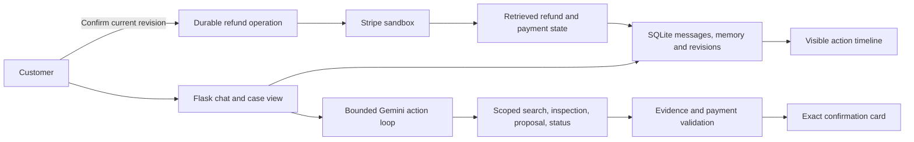

# Architecture and code map

Gemini interprets customer messages and chooses bounded actions; Python owns
validation, confirmation and payment execution. The demo selector establishes
customer scope in the session. Every case/order lookup enforces that scope, but
this is not production login.

## Agent and memory

The model returns a strict structured action, not executable code. The dispatcher
allows search, payment inspection, clarification, proposal and read-only refund
status. There is no model tool for authorizing or executing refunds. Tool/time
limits and repeated-call handling bound the loop. Chat fallback is bounded and
recorded; evaluation uses one fixed model.

SQLite stores messages, source-backed partial details, revisions, model turns and
events. Corrections invalidate affected details and old confirmation cards. Version
checks stop late model responses and stale browser tabs from overwriting newer
input. An unchanged purchase survives pauses and short replies; its evidence is
revalidated. Status reads cannot replay refund POSTs.

A pause is derived from persisted customer messages, so unrelated replies and
application restarts do not revive a withdrawn request. A fresh amount/full-refund
request allows a new proposal; evidence from before the pause cannot restore the
old amount. Numeric evidence also checks purchase-price and quantity/time cues.
Explicit “refund all” uses the current remaining balance, with exact confirmation
still required. These conservative English guards can ask for clarification when
wording is unsupported.

The comparison changes model context: full conversation history versus structured
case memory with selected messages and observations. Both arms share the execution
and authorization boundaries.

## Confirmation, execution and recovery

1. Resolve an owned purchase and ground amount/currency in customer evidence.
2. Check the payment and present an exact, versioned proposal.
3. Accept confirmation only for the current revision; persist the operation ID.
4. Recheck eligibility and submit with the operation's durable idempotency key.
5. Retrieve refund/payment state. Pending or unknown outcomes remain pending or
   reconciliation states, rather than model-declared success.

Background recovery retries eligible temporary failures within persisted limits.
Repeated confirmation reuses the same operation. Separately confirmed cases can
create additional partial refunds; the UI shows related cases but does not deduplicate
business intent. A confirmed refund cannot be cancelled through this prototype.

## Modules

| Area | Main files |
| --- | --- |
| App, configuration, web routes | `payresolve/__init__.py`, `config.py`, `dashboard.py` |
| Agent and model access | `agent.py`, `agent_contract.py`, `gemini_gateway.py`, `model_runtime.py` |
| Scope and durable cases | `catalog.py`, `cases.py`, `case_memory.py`, `case_boundary.py` |
| Payment policy and execution | `analysis.py`, `execution.py`, `workflow.py`, `operations.py`, `stripe_gateway.py` |
| Recovery and UI | `automation.py`, `case_view.py`, `templates/`, `static/` |
| Memory evaluation | `conversation_eval.py`, `conversation_provider.py`, `evals/conversations/` |
| Earlier experiments | `benchmark*.py`, `recovery*.py`, `ablations.py`, `rules.py` |
| Verification | `tests/`, `tools/check_setup.py`, `tools/check_chat_backup.py` |

Earlier experiment modules are retained because the CLI and tests still use them.
Their results are separate from the frozen memory comparison. See the
[final study](final-study.md) for observed evidence and limitations.
